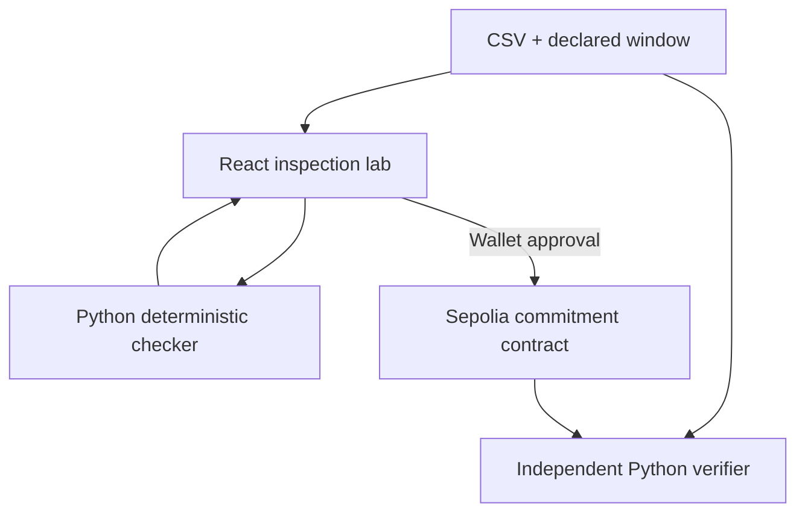

# Technical reference

[Project overview](../README.md) · [Documentation index](README.md) · [Contributing](../CONTRIBUTING.md)

Commands run from the repository root unless stated otherwise. V2 is the current app contract. V1 sections and workflows are retained as historical reproducibility records. Recorded RPC results describe the time they were checked.

## Evidence and verdicts

The observation window is start-inclusive and end-exclusive: `[windowStart, windowEnd)`. Expected timestamps occur at exact UTC hourly boundaries.

| Verdict | Code | Meaning |
| --- | --- | --- |
| `INTACT` | 0 | Every expected hour is present and no configured hard rule is violated |
| `GAPPED` | 1 | At least one expected hour is absent |
| `IMPOSSIBLE` | 2 | An in-window PM2.5 value violates the non-negative rule |

`IMPOSSIBLE` takes priority when a file also has gaps. Missing timestamps remain in the response. `materialGap` is true when more than two hours are missing in total; it is not a claim about a contiguous gap or scientific significance.

### Input requirements

| Input | Requirement |
| --- | --- |
| File | Non-empty CSV, at most 1,000,000 bytes, with a `.csv` filename for API uploads |
| Columns | `timestamp` and `value` |
| Timestamp | Parseable, unique instant, exactly on a UTC hour, including subsecond precision |
| Value | Finite numeric measurement; negative PM2.5 produces `IMPOSSIBLE` |
| Window | Starts at or after the Unix epoch, both ends hour-aligned, end after start, maximum 744 hours |
| Observations | At least one valid observation inside the declared window |
| Station | Non-empty identifier; use at most 31 UTF-8 bytes for web and independent on-chain verification |

The API and browser enforce the same 1–31 UTF-8 byte station limit and reject NUL characters, preventing ambiguous zero-padded encodings.

Timestamps without an explicit timezone are currently interpreted as UTC. Include `Z` or a timezone offset to avoid ambiguity. Out-of-window rows are validated and included in the exact-byte series hash, but do not count toward completeness or in-window physical-rule violations.

### Hash definitions

| Field | Definition |
| --- | --- |
| `seriesHash` | Ethereum Keccak-256 of the exact submitted CSV bytes |
| `gapHash` | Keccak-256 of the sorted missing UTC timestamps joined by newline characters, with no trailing newline |
| `policyHash` | Keccak-256 of the versioned checker policy identifier |
| Commitment key | V2: Keccak-256 of ABI-encoded `address publisher`, `bytes32 stationId`, `uint64 windowStart`, and `uint64 windowEnd`. Historical V1 omits publisher. |

The PM2.5 policy identifier is `gapwitness/pm25/hourly/v1`. The API also supports `generic` temporal inspection with its own policy hash; the web lab uses PM2.5.

Wallet and verifier station IDs use UTF-8 text padded with zero bytes to 32 bytes. A different byte order, whitespace, line ending, or measurement formatting changes the exact-byte series hash even if the displayed values look the same.

### Commitment rules

For the same publisher, station, and exact window in V2. Historical V1 uses only station and window:

- The first commitment stores the evidence, submitter, and block timestamp.
- An identical replay succeeds as a no-op, preserving the first submitter and timestamp and emitting no new `Committed` event.
- A changed gap hash reverts with `GapPaperedOver`.
- A changed series hash, policy hash, or verdict reverts with `CommitmentChanged`.
- A different station or window uses a different commitment key.

## Trust boundary

Temporal integrity does not establish sensor calibration, source honesty, scientific accuracy, or physical truth.

The Python checker computes the verdict, and the browser independently recomputes evidence before enabling commitment. The Solidity contract stores the submitted hashes and verdict and enforces consistency for an occupied station/window key. It does not parse the CSV, recompute the hashes, or authenticate a checker response.

The historical V1 contract is permissionless and uses a global station/window key. The first writer can occupy that key with arbitrary claims. V2 source includes the signing publisher in the key, preventing another wallet from occupying its namespace; the deployed V2 proof records its source-backed witness and publisher isolation. A station label does not establish ownership or source authority. A commitment is a timestamped submission to verify against the retained CSV, rather than a certified environmental record. There is no oracle signature or station-authorization registry.

No AI decides the verdict. Uploaded CSV bytes are transmitted to the configured checker. Only compact hashes, the verdict, and commitment metadata are stored on-chain. Retain the original file and declared window for independent verification.

## Demo data and provenance

### Frozen OpenAQ fixtures

| Property | Recorded value |
| --- | --- |
| Archive location | 2178, Del Norte |
| PM2.5 sensor | 3920 |
| Archive day | September 19, 2026 |
| Provider | AirNow |
| Recorded data license | US Public Domain |
| Acquisition date | October 5, 2026 UTC |
| UTC observation window | September 19 at 07:00 through September 20 at 07:00 |
| Source timestamp convention | `exclusive-time-ending` |

[data/source/openaq-demo.json](../data/source/openaq-demo.json) records the exact archive URL, archive SHA-256, sensor, selected window, removed hours, and fixture hashes.

| Fixture | Construction | Expected result |
| --- | --- | --- |
| [File A](../checker/demo/file_a.csv) | Seven rows removed from the frozen complete window, 15:00Z through 21:00Z | `GAPPED`, seven missing hours |
| [File B](../checker/demo/file_b.csv) | Selected source-window rows with measurements preserved | `INTACT` |
| [File C](../checker/demo/file_c_impossible.csv) | Deliberate impossible-measurement derivative | `IMPOSSIBLE` |

File A is an adversarial derivative. It does not demonstrate a naturally occurring gap in the upstream OpenAQ record. File C is a policy-test fixture, not an allegation about the source.

### Browser demo

The built-in two-state demo generates synthetic values locally and sends them to the real checker. Its comparison is labeled as different gap evidence, with no on-chain rejection tested. Custom uploads are labeled as unverified sources, rather than automatically attributed to OpenAQ. It shares the default station/window labels with the fixtures but does not use the frozen OpenAQ CSV bytes. Its hashes therefore differ from the source fixtures.

Use the repository fixtures when reproducing source-backed evidence or the chain demo. Do not describe the synthetic browser demo as observed OpenAQ measurements.

### Rebuild the fixtures

Do not hand-edit frozen fixture files. The source pipeline is:

1. Discover a complete hourly sensor window with `scripts/discover_openaq_window.py`.
2. Download a selected archive day with `scripts/fetch_openaq_day.py`.
3. Select the complete window with `scripts/select_openaq_window.py`.
4. Derive the explicit missing-hour file with `scripts/derive_openaq_fixtures.py`.
5. Derive the impossible-measurement fixture with `scripts/derive_impossible_fixture.py`.

Run each script with `--help` for its exact arguments. Selection, sensor identity, source bytes, timestamps, and generated hashes must be recorded together. [Source notes](../data/source/openaq.md) explain acquisition requirements.

## Architecture



| Layer | Stack | Responsibility |
| --- | --- | --- |
| Web | React 19, TypeScript, Vite, ethers v6 | Upload, visualization, evidence presentation, wallet interaction |
| Checker | Python, FastAPI, pandas, PyCryptodome | CSV validation, expected hours, verdicts, Keccak evidence |
| Contract | Solidity 0.8.24, Foundry | Immutable first-witness storage and conflict rejection |
| Verification | Python CLI and Ethereum JSON-RPC | Recompute evidence and compare on-chain fields |
| Hosting | Separate Vercel web/checker projects | Public browser client and HTTP checker |

## Run locally

For a compact setup guide, start with the [project README](../README.md#run-locally). Install Node dependencies in `web/`, not the repository root.

Prerequisites: Python 3.12, Node.js 22 or newer, npm, and Foundry for contract work. Run commands from the repository root unless stated otherwise.

### 1. Start the checker

```bash
python -m venv .venv
source .venv/bin/activate
python -m pip install -r checker/requirements.txt
python -m uvicorn app.main:app --app-dir checker --host 127.0.0.1 --port 8000
```

On Windows PowerShell, activate with `.\.venv\Scripts\Activate.ps1` instead of the Bash activation command. Check `http://127.0.0.1:8000/health` and interactive API docs at `http://127.0.0.1:8000/docs`.

### 2. Start the web lab

In a second terminal:

```bash
cd web
npm ci
cp .env.example .env
```

For PowerShell, use `Copy-Item .env.example .env`. Set the local checker URL in `web/.env`:

```dotenv
VITE_CHECKER_URL=http://127.0.0.1:8000
VITE_CONTRACT_V2=0x9988b2aa76e532b9093624ea8672543f368aca82
VITE_CONTRACT_DEPLOYMENT_BLOCK_V2=11911878
```

```bash
npm run dev
```

Open `http://localhost:5173`. The checker defaults to allowing that browser origin. Use the exact same hostname in your browser as the configured origin.

### Configuration

| Variable | Service | Purpose |
| --- | --- | --- |
| `VITE_CHECKER_URL` | Web | Checker base URL, defaults to `http://localhost:8000` |
| `VITE_CONTRACT_V2` | Web | Optional V2 address override; normally use the proved deployment manifest |
| `VITE_CONTRACT_DEPLOYMENT_BLOCK_V2` | Web | Optional V2 start block override for locating prior events |
| `WEB_ORIGIN` | Checker | Single allowed browser origin, default `http://localhost:5173` |
| `INSPECT_RATE_LIMIT` | Checker | Per-client inspection allowance, default 30 |
| `INSPECT_RATE_WINDOW_SECONDS` | Checker | In-memory rate-limit window, default 60 seconds |
| `PRIVATE_KEY` | Deployment only | Deployer wallet key, kept in encrypted workflow secrets |
| `SEPOLIA_RPC_URL` | Deployment/verification | Ethereum Sepolia JSON-RPC endpoint |
| `ETHERSCAN_API_KEY` | Optional source verification | Explorer verification credential |

Vite variables are public build-time settings. Never place secrets in a `VITE_*` variable. Environment changes require a new web deployment.

Production uses `https://gapwitness-checker.vercel.app` for the API and `https://gapwitness-web.vercel.app` as the checker CORS origin. Browser access requires public endpoints without a hosting sign-in wall. CORS controls browser access, not API authentication.

## API reference

### `GET /health`

Returns HTTP 200 with `ok`, service name, and checker version. This is a service reachability check, not proof of source freshness or contract health.

### `POST /inspect`

Multipart form fields:

| Field | Type | Required |
| --- | --- | --- |
| `stationId` | Text | Yes |
| `windowStart` | ISO timestamp | Yes |
| `windowEnd` | ISO timestamp | Yes |
| `seriesType` | `pm25` or `generic` | Defaults to `pm25` |
| `csv` | CSV upload | Yes |

```bash
curl -X POST http://127.0.0.1:8000/inspect \
  -F stationId=2178 \
  -F windowStart=2026-09-19T07:00:00Z \
  -F windowEnd=2026-09-20T07:00:00Z \
  -F seriesType=pm25 \
  -F csv=@checker/demo/file_a.csv
```

A successful response contains station/window context, expected and observed hours, normalized in-window `observations` with UTC timestamps and numeric values, missing timestamps, impossible timestamps, verdict/code, three hashes, and a `chainCommitment` object with Unix-second window boundaries.

HTTP 422 indicates unusable input, including duplicate/off-hour timestamps, non-finite values, an oversized window, or no observations inside the window. These are inspection errors, not verdicts. HTTP 429 includes `Retry-After`. The web surfaces failures without manufacturing a local verdict and disables commitment when the checker is unavailable.

## Independent verification

### Recompute local evidence

```bash
python verify.py checker/demo/file_a.csv \
  --station-id 2178 \
  --window-start 2026-09-19T07:00:00Z \
  --window-end 2026-09-20T07:00:00Z
```

### Compare with the current V2 record

```bash
python scripts/verify_onchain.py checker/demo/file_a.csv \
  --station-id 2178 \
  --window-start 2026-09-19T07:00:00Z \
  --window-end 2026-09-20T07:00:00Z \
  --contract 0x9988b2aa76e532b9093624ea8672543f368aca82 \
  --publisher 0x541291139b59570d1cd5d0e64df217b3f6efd7c8 \
  --rpc-url https://ethereum-sepolia-rpc.publicnode.com
```

This verifier checks Sepolia chain identity, commitment existence, and matching series, gap, policy, and verdict fields. It emits JSON and exits 0 only on a complete match. It does not trust the browser.

The CSV must already have been committed for that exact station/window. Deploying a contract or running the synthetic replay regression does not commit File A. A missing record correctly produces a failed verification.

### Generate a historical V1 fixture proof report

```bash
python scripts/build_demo_proof.py \
  --contract 0x81433d6bedf33b72defe0b90534dc16cc2b0bc57 \
  --deployment-tx 0xe073807470287af98f97f903a54da5d13edf51cbeaad987c13e314c62f0c018d \
  --deployment-block 11850947 \
  --output /tmp/gapwitness-demo-proof.json
```

This legacy V1 report recomputes fixture evidence and records supplied deployment metadata. It does not itself broadcast transactions or prove that the frozen fixtures are committed.

## Sepolia deployment and live proof

### Current publisher-scoped V2 deployment

| Field | Value |
| --- | --- |
| Contract | [`0x9988b2aa76e532b9093624ea8672543f368aca82`](https://sepolia.etherscan.io/address/0x9988b2aa76e532b9093624ea8672543f368aca82) |
| Deployment transaction | [`0x8cbd2951e5fe7b3640c6f1e81021d2953c347ddd10338a30446e9d0688b5c4b0`](https://sepolia.etherscan.io/tx/0x8cbd2951e5fe7b3640c6f1e81021d2953c347ddd10338a30446e9d0688b5c4b0) |
| Deployment block | `11911878` |
| Publisher-scoped File A transaction | [`0xbca8fc950d106c7952ec78787bd8b57181d4ec4febb3882653318ea6dea7ad08`](https://sepolia.etherscan.io/tx/0xbca8fc950d106c7952ec78787bd8b57181d4ec4febb3882653318ea6dea7ad08) |
| Fixture publisher | `0x541291139b59570d1cd5d0e64df217b3f6efd7c8` |
| Deployment and proof | [sepolia-v2.json](../contracts/deployments/sepolia-v2.json), [fixture-proof-v2.json](../contracts/deployments/fixture-proof-v2.json) |
| Source verification | Exact creation and runtime matches are retained in [sourcify-v2.json](../contracts/deployments/sourcify-v2.json). Separate Etherscan verification is optional. |

The web uses `web/src/lib/deployment.ts` and checks its recorded runtime hash before commitment. Legacy `VITE_CONTRACT` values cannot silently override the V2 default. Optional V2 overrides use the explicitly named V2 variables.

The live proof verifies File A's stored hashes and verdict, File B rejection for its original publisher at a mined block, and distinct publisher keys agreeing between Python and Solidity. An outsider's submission is simulated in its own namespace. The Foundry fuzz test additionally proves that an attacker's actual state mutation in the local EVM cannot occupy another publisher's record. The outsider simulation is not a mined attacker transaction.

Verify the V2 fixture independently:

```bash
python scripts/verify_onchain.py checker/demo/file_a.csv --station-id 2178 \
  --window-start 2026-09-19T07:00:00Z --window-end 2026-09-20T07:00:00Z \
  --contract 0x9988b2aa76e532b9093624ea8672543f368aca82 \
  --publisher 0x541291139b59570d1cd5d0e64df217b3f6efd7c8
```

### Historical corrected V1 deployment

| Field | Value |
| --- | --- |
| Chain | Ethereum Sepolia, `11155111` |
| Contract | [`0x81433d6bedf33b72defe0b90534dc16cc2b0bc57`](https://sepolia.etherscan.io/address/0x81433d6bedf33b72defe0b90534dc16cc2b0bc57) |
| Deployment transaction | [`0xe073807470287af98f97f903a54da5d13edf51cbeaad987c13e314c62f0c018d`](https://sepolia.etherscan.io/tx/0xe073807470287af98f97f903a54da5d13edf51cbeaad987c13e314c62f0c018d) |
| Deployment block | `11850947` |
| Source commit | `d93102c11f8076f73ab2bcbcfd039541ac36568b` |
| Deployment record | [contracts/deployments/sepolia.json](../contracts/deployments/sepolia.json) |
| Explorer source verification | Not recorded as verified |

The earlier address `0xa7ab2d2e60a08a089f3749ac3e98b41449b23211` is historical and lacks the replay-provenance fix. It was not upgraded. Use the corrected address above.

### Mined replay evidence

[contracts/deployments/replay-proof.json](../contracts/deployments/replay-proof.json) contains the commitment key, original storage, storage after replay, and both mined receipts.

- [First submission](https://sepolia.etherscan.io/tx/0x8cfb9fd4af3716ffc680363efdd5c9ce522b1c375e3f6e5b81220559369a0cd9) created the witness.
- [Exact replay](https://sepolia.etherscan.io/tx/0x85803de16c1e8a0b8c580d4b2c07e6a3feca25d9ca0c02dad939bcb7b0881ad8) succeeded in the next block, preserved every stored field, and emitted no event.

This is synthetic contract-regression evidence. It is distinct from the environmental fixture demo.

### Source-backed fixture evidence

[contracts/deployments/fixture-proof.json](../contracts/deployments/fixture-proof.json) records a successfully mined commitment of frozen File A on the corrected contract:

- [File A transaction](https://sepolia.etherscan.io/tx/0xb5fe1bae272e7c3e28bada96867b404c9dcb4eba0b9d786201575edd5291b1e6).
- Station `2178`, window September 19, 2026 at 07:00Z through September 20 at 07:00Z.
- Independently recomputed series, gap, policy, and verdict all match stored evidence.
- File B returned the exact `GapPaperedOver` selector and both expected gap hashes through `eth_call` at Sepolia block `11911618`.

File B's rejection was checked against mined state. It is not a mined failed transaction. File A's seven missing hours were deliberately removed from a complete source window.

### Deployment workflows

The owner-only `/deploy-sepolia` issue-comment workflow runs contract tests, dry-runs, broadcasts, records deployment metadata, submits the live replay proof, uploads the proof artifact, and publishes a deployment-record branch. Review and integrate the new address/block before configuring the web.

The separate `deploy-sepolia` workflow supports manual dispatch and optional Etherscan source verification through the `sepolia` environment. It does not automatically run the replay proof.

Both routes need a funded testnet deployer and protected credentials. A deployment creates a new contract and does not migrate earlier commitments.

### Source-backed on-chain proof run

The owner can run the `final-evidence` workflow manually, or create an owner-controlled `proof-run/**` branch. Its two independent jobs:

1. Use the corrected deployment record, recompute frozen File A, commit it only if the key is empty, compare all stored hashes and the verdict, retain the original receipt, and check File B's exact `GapPaperedOver` error payload with `eth_call` against a recorded mined block. A conflicting existing record fails rather than overwriting evidence. The public report is uploaded and committed on an `ops/fixture-proof-*` branch for integration.
2. Verify the existing contract on Etherscan using `ETHERSCAN_API_KEY` and the exact deployment source revision. It does not deploy a new contract. Verification is marked true on an `ops/explorer-verification-*` branch only after the explorer verification command succeeds.

The proof script is `scripts/prove_fixture_onchain.py`. File A is an adversarial derivative of the frozen source, not a naturally missing upstream record. File B's rejection is an RPC execution check against mined state, not a mined failed transaction. The source-backed fixture job succeeded on October 14, 2026, and its report is included above. Explorer verification remains blocked because `ETHERSCAN_API_KEY` is not configured. Add that secret in the repository Actions settings or the `sepolia` environment, then rerun the explorer job. The workflow prepares and uploads the exact deployment compiler input before requesting explorer verification.

## Tests and reproducibility

### Checker and source pipeline

```bash
cd checker
python -m pytest -q
python ../scripts/test_prepare_chain_demo.py
python demo/run_demo.py
```

### Contract

```bash
cd contracts
forge install https://github.com/foundry-rs/forge-std --no-git
forge build
forge test -vv
```

Replay tests assert that a different wallet and later timestamp cannot overwrite the first witness and that no duplicate evidence event is emitted. Fuzz tests vary callers and replay timing. The regressions fail against the earlier implementation.

### Web

```bash
cd web
npm ci
npm run build
```

GitHub Actions cover the checker, source processing, contract, web build, deployment-record parsing, and deterministic fixture proof. The frozen OpenAQ fixture demo must remain reproducible from its manifests.

For the adversarial chain rehearsal, `scripts/prepare_chain_demo.py --contract <ADDRESS>` generates the frozen fixture inputs, and `contracts/script/DemoGapPaperOver.s.sol` attempts File A followed by conflicting File B. This is a separate broadcast operation requiring test ETH.

### Web regression checks

With the local checker running on port 8000:

```bash
cd web
npm ci
npm test
npx playwright install chromium
VITE_CONTRACT_V2=0x2222222222222222222222222222222222222222 npm run test:browser
```

Browser regressions exercise real checker responses, quoted CSV observations, changed-input invalidation and retry, cancellation of older requests, and replacing an in-flight demo with a new upload. Wallet regressions cover the custom-error ABI, nested provider revert data, and disconnect events.

